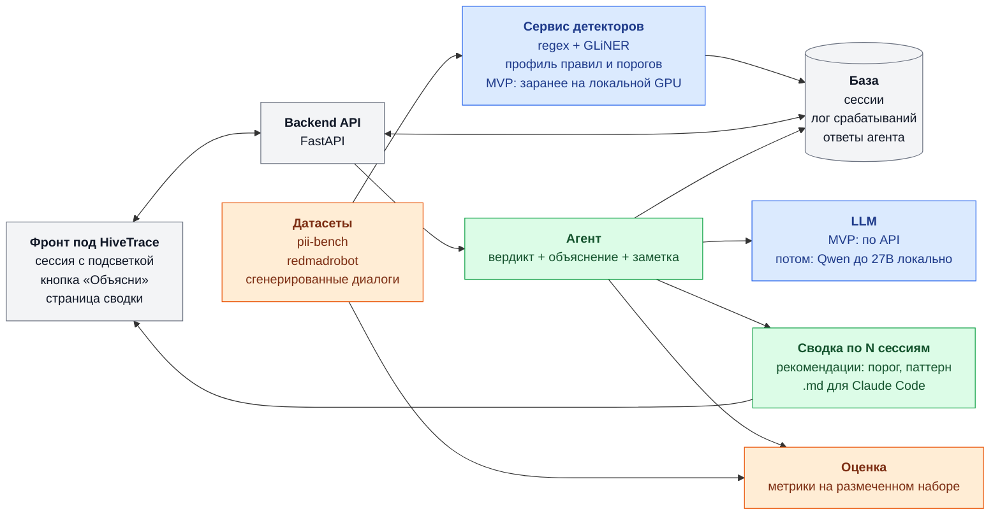

# Чекпоинт 1 — минимальный системный дизайн

Цвета: синий — Детекторы и модели, оранжевый — Данные и оценка, зелёный — Агент, серый — общее.

**Поток одного запроса**

1. Сессия загружена в базу.
2. Детекторы заранее прогоняются по сессии на локальной GPU, лог срабатываний загружается в базу.
3. Админ во фронте жмёт «Объясни».
4. Агент читает переписку и лог (включая отклонённые кандидаты), при необходимости перепроверяет регулярками и проверяет контрольную сумму.
5. Вердикт, ссылка на место в переписке и рекомендация видны во фронте.

**Эндпоинты** (без реализации): `POST /sessions`, `GET /sessions/{id}`, `GET /sessions/{id}/detections`, `POST /sessions/{id}/explain`, `POST /summary`.

**Стек и развёртывание**

- Python 3.12, FastAPI, pydantic (форматы из `backend/schemas`), SQLite на MVP.
- Фронт и backend на одном VPS без GPU через docker-compose.
- Сервис детекторов (`backend/detectors`) — отдельный контейнер с GPU. На MVP запускается локально, на сервер попадают готовые логи; перезапуск модели на сервере — после MVP, если появится режим на CPU.
- LLM на MVP по API, после MVP — локальная Qwen до 27B на GPU-квоте (рядом с инференсом HiveTrace на 40–60 ГБ).

**Чего нет в MVP**

- Правок детектора в проде: только рекомендации.
- Дообучения моделей.
- Авторизации.
