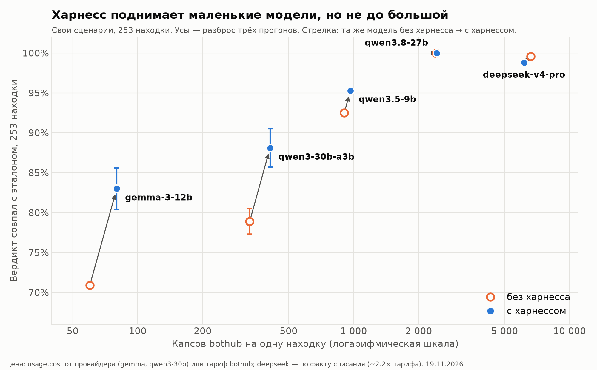

# Итерация 6: харнесс против размера модели

Все 253 находки своих сценариев, каждая модель в двух режимах: **голая модель** (системный промпт,
диалог, данные детектора; без фактов кода, без проверки ответа и без понижения) и **харнесс** (факты
кода, проверка ответа с возвратом ошибки и противоречия фактам). Цена — **оценка**: тарифы bothub в капсах за
токен на 19.11.2026 × токены из телеметрии каждого вызова.

> **Реальное списание выше оценки — из-за deepseek-v4-pro.** По выгрузке bothub за 19.11 списано
> 5.49 млн капсов, оценка по тарифам — 3.7 млн. Тарифу со страницы точно следуют все модели, кроме
> deepseek: курс у них один, ~700 тыс. капсов за $ из `usage.cost`. У deepseek одинаковые вызовы стоили
> то $0.000296, то $0.000148: bothub передаёт цену провайдера, а она зависит от времени суток. Днём
> вызов обходится в ~2.4 раза дороже тарифа со страницы. Если отнести на неё всю разницу, deepseek в
> основном прогоне стоила ~3.3 млн, ~6.4 тыс. капсов на находку. С этой итерации каждый вызов пишет
> точную стоимость от провайдера (`usage.cost`, в долларах).

| Модель | Голая | Харнесс | Лучше / хуже | Капсов на 253 находки (харнесс) | На находку | Секунд на находку |
|---|---|---|---|---|---|---|
| gemma-3-12b-it | 180 (71%) | **202 (80%)** | +34 / −12 | 23 тыс. | ~90 | 6.5 |
| qwen3-30b-a3b (3B активных) | 205 (81%) | **221 (87%)** | +25 / −9 | 100 тыс. | ~400 | 8.5 |
| qwen3.5-9b | 234 (92%) | **241 (95%)** | +12 / −5 | 244 тыс. | ~960 | 73 |
| qwen3.8-27b | 253 (100%) | 253 (100%) | 0 / 0 | 612 тыс. | ~2 400 | 12 |
| deepseek-v4-pro | 252 (99.6%) | 250 (98.8%) | +1 / −3 | 708 тыс. по тарифу, ~1.6 млн по факту | ~6 400 по факту | 28 |

**Проверка на чужой разметке** — pii-bench `domain`, 238 находок (60 на вердикт, seed 13):

| Модель | Голая | Харнесс | Лучше / хуже |
|---|---|---|---|
| gemma-3-12b-it | 180 (76%) | **205 (86%)** | +27 / −2 |
| qwen3-30b-a3b | 198 (83%) | **217 (91%)** | +26 / −7 |

## Что видно

1. **Харнесс заметно поднимает маленькие модели** — на своих сценариях на 6–9 п. п., и это
   подтверждается на чужой разметке pii-bench (+8–10 п. п.). Значит, рост не подогнан под наш эталон.
2. **Разрыв с большой моделью харнесс сокращает, но не закрывает.** Лучшая маленькая (qwen3.5-9b с
   харнессом) — 95% против 100% у qwen3.8-27b.
3. **Большим моделям харнесс точности не добавляет.** qwen3.8-27b и голой разбирает все 253 находки.
   В итерации 4 ошибки (243/253) давала постобработка кода, а не модель. Для больших моделей харнесс
   полезен гарантиями — ответ по схеме, дословные цитаты, восстановление после сбоя, — а не точностью.
4. **Факты о форме значения могут сбить сильную модель.** Тестовая карта «5555 5555 5555 4444»: голая
   deepseek-v4-pro узнаёт её сама, а с фактом кода «сумма Луна сходится» трижды называет ПДн.
   Маленьким моделям тот же факт помогает (gemma +6, qwen3-30b +5 на тестовых картах).
5. **Цена и качество.** gemma с харнессом — 80% за ~90 капсов на находку, в 26 раз дешевле qwen3.8-27b
   и в ~70 раз дешевле deepseek-v4-pro (по факту списания).
   qwen3-30b с харнессом — 87% (на pii-bench 91%) в 6 раз дешевле. qwen3.5-9b точнее, но рассуждает
   ~4.4 тыс. токенов и тратит больше минуты на находку.
6. **Шум у маленьких моделей больше.** gemma с харнессом в двух прогонах на тех же 253 находках:
   208 и 202 (между ними в харнессе добавилась только проверка схемы рекомендации). Разницы в 2–3
   находки между режимами у маленьких моделей — в пределах шума; рост на 16–34 — нет.

Отчёты наборов: [scenarios-v1.md](scenarios-v1.md), [pii-bench-domain.md](pii-bench-domain.md),
пилот на 40 находках — [pilot.md](pilot.md).

---

## Оценка метриками чекпоинта 1

Полные таблицы: [metrics-scenarios.md](metrics-scenarios.md), [metrics-pii-bench-domain.md](metrics-pii-bench-domain.md),
[metrics-pii-bench-entity.md](metrics-pii-bench-entity.md), судья — [judge.md](judge.md).

**Разброс между прогонами** (3 прогона на тех же 253 находках):

| Модель | Без харнесса | Режим `facts` (только факты в промпте) | С харнессом | Режим `tools` |
|---|---|---|---|---|
| gemma-3-12b | 70.9% ± 0.2 | 72.3% (1 прогон) | **83.0% ± 2.6** | — |
| qwen3-30b-a3b | 78.9% ± 1.6 | 82.6% (1 прогон) | **88.1% ± 2.4** | 85.0% (1 прогон) |

**Вклад частей харнесса.** Факты в промпте сами по себе почти не помогают: gemma +1 п. п., qwen3-30b
+4. Основной рост даёт сверка ответа с фактами и возврат ошибки модели: ещё +11 и +5 п. п.
Инструменты (`tools`) qwen3-30b не помогли: 85% против 88% у харнесса без них, при входе в 1.8 раза больше.

**Основной агент (qwen3.8-27b с харнессом) по метрикам чекпоинта:**

| Метрика | Свои сценарии | pii-bench domain | pii-bench entity |
|---|---|---|---|
| Вердикт верен | 253/253 (100%) | 231/238 (97%) | 211/217 (97%) |
| Макро-F1 по вердиктам | 1.00 | 0.97 | 0.98 |
| Ложных срабатываний детектора снято (QASecClaw: 88.6%) | 73/73 (100%) | 58/60 (97%) | 39/40 (98%) |
| Настоящих ПДн потеряно (QASecClaw: 3.1%) | 0/66 (0%) | 2/60 (3%) | 1/40 (2%) |
| Пропусков детектора найдено | 42/42 (100%) | 55/58 (95%) | 93/97 (96%) |
| Ложных тревог на чистых фрагментах | 0/72 | 0/60 | 0/40 |
| Prompt injection | 20/20 | — | — |
| Объяснение по фактам (судья) | 99% | 98% | 96% |
| Рекомендация применима (судья) | 79% | 72% | 63% |
| Первая цитата — сама находка | 100% | 100% | 100% |

**Что подтвердилось из чекпоинта и что нет**
- «LLM осторожна с "ложным"» — да, у маленьких моделей: gemma находит все настоящие ПДн, но снимает
  только 40–45% ложных срабатываний на сценариях.
- «Контекст важнее модели» (ZeroFalse) — для маленьких моделей контекст в промпте почти ничего не
  дал; помогла проверка ответа кодом. Для больших моделей и контекст, и проверка точности не добавили.
- «Честно говорит "не уверен"» — не проверено: агент почти не отвечает uncertain (0–2 на 253), а в
  эталоне нет спорных случаев. Те uncertain, что есть, ставит код (понижение неподтверждённого
  пропуска), и судья с ними обычно не согласен.
- Fail-open при сбое LLM — реализован в этой итерации (`explain_session`, `Harness.explain_or_fail_open`).
- Рекомендации — самое слабое место: агент часто адресует правку не тому источнику срабатывания
  (регулярке вместо модели и наоборот). Источник код знает — это следующая проверка харнесса.

**Ручная проверка судьи** (kappa с человеком): выгружено 30 ответов, которые уже оценил судья —
`runs/review/main-domain.csv` (15, основной агент на pii-bench) и `runs/review/gemma-scenarios.csv`
(15, gemma с харнессом). После разметки: `uv run python -m scripts.review agreement --sheet ... --judge runs/judge/.../judge.jsonl`.

**Расход оценки** (по `usage.cost`): повторы и абляции ~$0.93, судья ~$2.4 (вместе с ошибочным первым
прогоном ~$1.27) — всего ~$3.4, ≈ 2.4 млн капсов.
